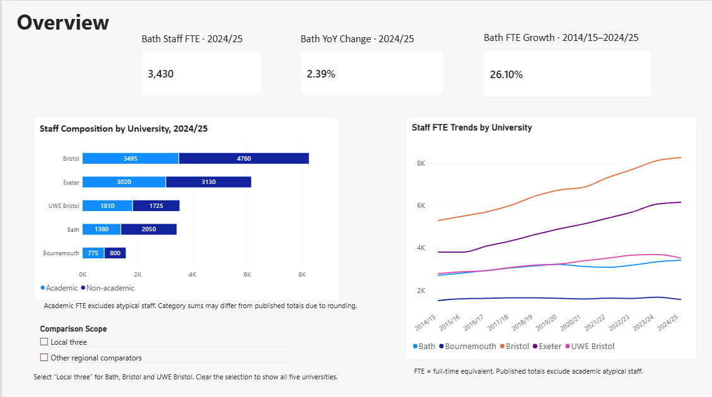
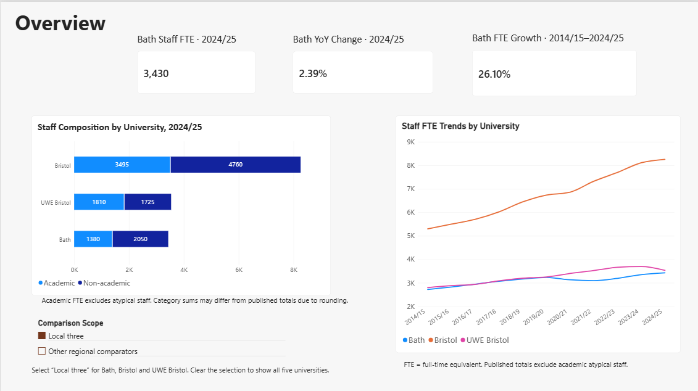
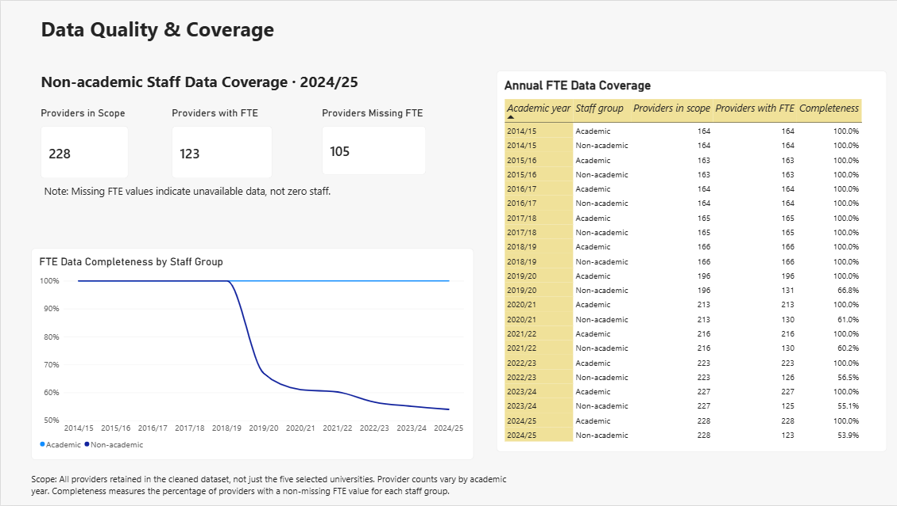
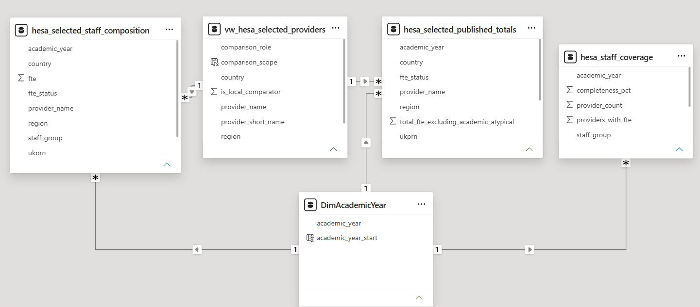

# HESA Workforce Intelligence

UK higher education workforce analysis and data quality assessment using **SQL Server, Power Query and Power BI**.

This project examines staff full-time equivalent (FTE) trends at the University of Bath and four regional comparators, while separately assessing how missing data affects the wider dataset. It covers **2014/15–2024/25** using HESA Staff Table 6.

## Questions

- How has Bath's published staff FTE changed over time?
- How do workforce size and academic/non-academic composition compare across selected universities?
- How complete are provider-level FTE data, and what limits cross-provider comparisons?

## Key findings

| Measure | Result |
|---|---:|
| Bath published staff FTE, 2024/25 | 3,430 |
| Change from 2023/24 | +80 FTE (+2.39%) |
| Growth from 2014/15 to 2024/25 | +710 FTE (+26.10%) |
| Bath academic FTE, 2024/25 | 1,380 |
| Bath non-academic FTE, 2024/25 | 2,050 |
| Non-academic FTE coverage across retained providers, 2024/25 | 123 of 228 (53.9%) |

Published totals exclude academic atypical staff. The 26.10% figure is cumulative growth, not an annualised growth rate. Bath's published total fell in 2020/21 and 2021/22 before increasing in the next three years. These are descriptive findings, not evidence of the causes of workforce changes.

## Dashboards

### Workforce Overview

Five selected South West England universities with complete composition and published-total data across the 11-year period: **Bath, Bristol, UWE Bristol, Exeter and Bournemouth**. They are geographic comparators, not a claim of equivalent academic profiles, funding or institutional missions.

The scope slicer selects a Bath–Bristol subgroup: **Bath, Bristol and UWE Bristol**. Clear its selection to restore all five. Selecting “Other regional comparators” shows Exeter and Bournemouth only. Bath KPI cards remain fixed to their stated institution and periods.

View the local three-university comparison

### Data Quality & Coverage

Coverage includes all providers retained by the SQL cleaning rules, not just the five selected universities. Academic FTE is present for all retained provider records in each year, while non-academic completeness falls from 100% in 2018/19 to 53.9% in 2024/25. Provider counts also change across years.

**Missing FTE is not zero staff.** Comparing totals from changing sets of reporting providers can confound workforce change with changes in data coverage. The five-provider analysis uses a complete-data subset, which should not be treated as representative of the whole sector.

## Workflow and checks

1. Prepare the CSV for import by removing its metadata preamble and mapping nine source headers to SQL names.
2. Import source values as nullable text into `HESA_Workforce.dbo.hesa_table6_raw`.
3. Use SQL views to trim identifiers, convert FTE with `TRY_CONVERT`, and distinguish missing values from invalid numeric values.
4. Retain identified providers, non-aggregate geographic representations and matching staff-category markers.
5. Separate mutually exclusive staff categories from published totals to avoid double counting.
6. Validate provider–year–staff-group uniqueness, category mapping, coverage and Bath's category-to-total reconciliation. Use `LAG` for annual change analysis.
7. In Power Query, retain unfiltered source queries, build a coverage summary and use inner merges with the selected-provider list to create comparison facts.
8. Build one-to-many, single-direction model relationships and DAX measures in Power BI.

The imported snapshot contained **238,113 rows**, including **8,613 rows with no UKPRN** and **27,912 rows with missing FTE**. These are raw-data counts, not counts of missing values in the final five-provider analysis. The final provider-year-staff-group check returned no duplicates or unmapped staff groups.

## Model

The selected-provider dimension filters both comparison facts. The academic-year dimension filters both comparison facts and the coverage summary. The provider dimension has no relationship to the coverage summary, preserving its wider scope.

- [Data dictionary and schema mapping](docs/data_dictionary.md)
- [Reproduction guide](docs/reproduction.md)
- [SQL preparation and validation](sql/01_hesa_data_preparation_and_validation.sql)
- [Download the Power BI report](powerbi/HESA_Workforce_Intelligence.pbix)

## Interpretation limits

- FTE measures staff capacity, not headcount, productivity, cost or service quality.
- Published totals and individual categories are rounded separately. Bath's category sum differs from its published total by +5, +5 and −5 FTE in 2014/15, 2016/17 and 2017/18 respectively. Published totals are used for overall trends and growth measures.
- Academic and non-academic categories must not be added to the published total as if they were three independent groups.
- Completeness is calculated separately for each academic year and staff group. It measures available numeric FTE values, not accuracy or the completeness of every institution in the UK.
- The selected-provider list and headline KPI periods are fixed to this project snapshot. Extending the analysis requires reviewing these definitions.
- Excel working notes are not included: they retain intermediate debugging outputs that should not be read as final results.

## Source

Source: [HESA Staff Table 6](https://www.hesa.ac.uk/data-and-analysis/staff/table-6), available through the [HESA staff data collection](https://www.hesa.ac.uk/data-and-analysis/staff). Consult the [staff definitions](https://www.hesa.ac.uk/support/definitions/staff) for scope and reporting guidance.

The source CSV identifies the data as available under **Creative Commons Attribution 4.0**. This project removes metadata rows, renames columns, filters records and calculates derived measures. The dataset may be revised after download; the figures above describe the snapshot used in this report. This is an independent portfolio project, not an official HESA or University of Bath publication.
